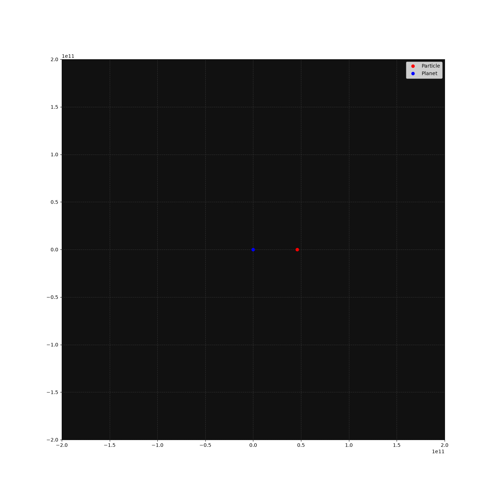
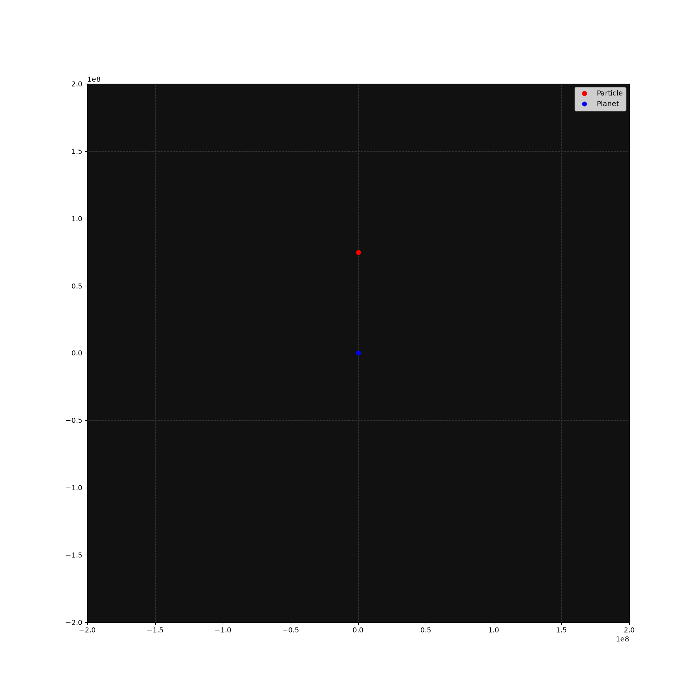

# Computational Physics Simulations: Newtonian + Schwarzschildean Orbits & Special Relativistic Calculations

This portfolio displays different physical scenarios that I theoretically derived and computationally simulated from 10/18 - 10/20.

-----

## Project 1: Schwarzschildean Orbits in the Form of the Precession of the Perihelion of Mercury [10/20]


A precise model of Mercury's orbit using Schwarzschildean geometry to correct Newton's model and accurately describe Mercury's orbit around the Sun.

## Core Mechanics
* Evaluates the radial acceleration with the Schwarzschild correction term at every point
* Utilizes a theoretically derived relativistic angular momentum term to evaluate both radial acceleration and angular velocity at every point
* Makes use of a custom built Vector3 struct in order to make calculations easier
* Uses a polar-to-cartesian conversion function to make animation easier

-----

## Project 2: Special Relativity Boost Calculator [10/19]

A program which contracts the Lorentz Transformation matrix with a boosted four-vector and prints out the resultant boosted four-vector in a new 
reference frame along with proving the invariance of the metric equation.

## Core Mechanics
* Builds the Lorentz Transformation matrix with provided boost factors and calculated Lorentz factors
* Uses a custom-built metric struct with a matrix-vector multiplication function to calculate the primed four-vector
* Utilizes a interval calculation function to numerically show the invariance of the metric equation

-----

## Project 3: Newtonian Circular Orbits [10/18]


A model of a uniform circular orbit using standard Newtonian mechanics.

## Core Mechanics

* Evaluates the Newtonian gravitational acceleration of a mass at every point using standard Newtonian mechanics
* Makes use of Cowell's method to simulate gravity

-----

## How to Execute Pipelines
### 1. Precession of Mercury & Schwarzschildean Orbits

```bash
g++ -o mercury_sim ./schwarzschild_gravity.cpp
./mercury_sim > schwarzschildean_orbit_data.csv
python animate_schwarzschild_orbit.py
```

### 2. Verify Lorentz Invariance

```bash
g++ -o sr_sim ./sr_transform.cpp
./sr_sim
```

### 3. Newtonian Orbits

```bash
g++ -o orbit_sim ./newtonian_gravity.cpp
./orbit_sim > orbit_data.csv
python animate_newtonian_orbit.py
```
